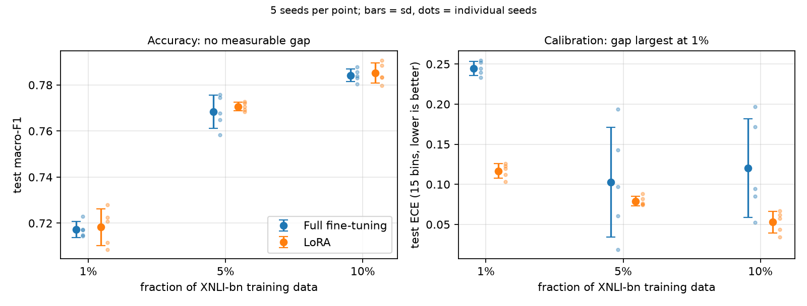
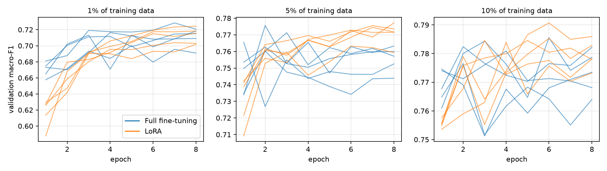

# LoRA vs full fine-tuning for Bangla NLI

BSc thesis project. It compares LoRA with full fine-tuning of
[BanglaBERT](https://huggingface.co/csebuetnlp/banglabert) on
[XNLI-bn](https://huggingface.co/datasets/csebuetnlp/xnli_bn) (3-class natural language
inference) under a matched training budget. Both methods are trained on 1%, 5% and 10% of
the training set with five seeds each, for 30 runs.

## Summary

| | Result |
|---|---|
| Accuracy | No measurable difference at any data size (gaps +0.0010 to +0.0024, every 95% CI includes zero). Equivalent within ±0.01 macro-F1 at 1% and 10%; at 5% the test sits exactly on the boundary. |
| Calibration | At 1% data, full fine-tuning is badly overconfident (ECE 0.245 vs 0.117), consistently across seeds. At 5% and 10% the raw gap is not consistent across seeds. After temperature scaling LoRA keeps a small edge in every seed at every fraction; it meets the robustness rule at 1% and 5% but not at 10%. |
| Efficiency | LoRA trains 0.80% of the parameters, saves a 124× smaller artefact, and uses 25% (T4) to 42% (A100) less peak GPU memory. |
| Speed | LoRA is 1.5–2.1× faster on a T4 but not faster on an A100 (parity at 1%, about 6% slower at 5–10%). |



## Setup

| | |
|---|---|
| Base model | `csebuetnlp/banglabert` (110.6M parameters) |
| Data | `csebuetnlp/xnli_bn`: 381,449 train / 2,419 validation / 4,895 test |
| Preprocessing | `csebuetnlp/normalizer` on both sentences, max length 128 |
| Full fine-tuning | all parameters, learning rate 2e-5 |
| LoRA | r=8, alpha=16, dropout 0.1, on `query` and `value`, learning rate 2e-4 |
| Training | 8 epochs, batch size 16, fp16, no early stopping |
| Model selection | epoch with the best validation macro-F1; test scored once per run |
| Subsets | `train.shuffle(seed).select(range(n))`: same subset for both methods per seed (indices not saved) |
| Seeds | 7, 13, 21, 33, 42 |

Both methods get the same fixed budget. In a pilot, early stopping with patience 2 stopped
full fine-tuning at epoch 4 while LoRA was still improving, which made the comparison
depend on the stopping rule. Validation macro-F1 is used for selection because it is the
reported metric. At 5%, full fine-tuning's validation loss rises from 0.64 to 1.58 over
training while its macro-F1 peaks at epochs 1–4.

## Results

All numbers come from `python src/analyze.py`. The full output is in
[`results/stats.txt`](results/stats.txt).

### Accuracy

| Fraction | Full FT macro-F1 | LoRA macro-F1 | Gap (LoRA − full) | 95% CI | p (paired t) |
|---|---|---|---|---|---|
| 1% (3,814) | 0.7172 ± 0.0034 | 0.7183 ± 0.0080 | +0.0010 | [−0.0054, +0.0074] | 0.685 |
| 5% (19,072) | 0.7683 ± 0.0072 | 0.7706 ± 0.0019 | +0.0024 | [−0.0076, +0.0123] | 0.547 |
| 10% (38,144) | 0.7842 ± 0.0027 | 0.7851 ± 0.0044 | +0.0010 | [−0.0062, +0.0082] | 0.728 |

± is the standard deviation over seeds. Per-seed exact McNemar tests: 1 of 15 has
p < 0.05 and none survives Holm correction.

Equivalence is tested with TOST at a margin of ±0.01 macro-F1 (one point). The margin was
set in the analysis after the runs had finished; it was not pre-registered.

| Fraction | 90% CI of the gap | TOST p (±0.01) |
|---|---|---|
| 1% | [−0.0039, +0.0059] | 0.009 |
| 5% | [−0.0053, +0.0100] | 0.050 |
| 10% | [−0.0046, +0.0065] | 0.013 |

At 5% the upper bound of the 90% CI equals the margin (p = 0.049997), so equivalence there
depends on the fourth decimal and is not claimed.

The two methods reach the same score with different predictions. They agree on 83.9% (1%),
86.6% (5%) and 86.9% (10%) of test items.

### Calibration

Differences are LoRA minus full fine-tuning, so negative means LoRA is better calibrated.
ECE uses 15 equal-width bins over the attainable confidence range [1/3, 1].

Two intervals are given because they answer different questions. The **seed-level** CI
(paired t over the five seeds) includes training variability: it indicates whether
retraining would give the same answer. The **item-level** CI (paired bootstrap over test
items, models held fixed) only covers test-set sampling noise for these five models, and is
always much narrower.

| Fraction | Metric | Full FT | LoRA | Difference | Seed-level 95% CI | p | LoRA lower | Item-level 95% CI |
|---|---|---|---|---|---|---|---|---|
| 1% | ECE | 0.245 | 0.117 | −0.128 | [−0.139, −0.117] | 5 × 10⁻⁶ | 5/5 | [−0.134, −0.121] |
| | Brier | 0.517 | 0.416 | −0.101 | [−0.110, −0.091] | 8 × 10⁻⁶ | 5/5 | [−0.110, −0.091] |
| | NLL | 1.334 | 0.754 | −0.579 | [−0.718, −0.441] | 0.0003 | 5/5 | [−0.611, −0.546] |
| | ECE after T | 0.066 | 0.026 | −0.040 | [−0.056, −0.024] | 0.002 | 5/5 | [−0.043, −0.029] |
| 5% | ECE | 0.103 | 0.079 | −0.023 | [−0.102, +0.056] | 0.46 | 3/5 | [−0.030, −0.019] |
| | Brier | 0.362 | 0.338 | −0.023 | [−0.068, +0.021] | 0.21 | 4/5 | [−0.030, −0.017] |
| | NLL | 0.721 | 0.614 | −0.108 | [−0.340, +0.124] | 0.27 | 3/5 | [−0.122, −0.094] |
| | ECE after T | 0.034 | 0.017 | −0.017 | [−0.030, −0.003] | 0.027 | 5/5 | [−0.018, −0.007] |
| 10% | ECE | 0.120 | 0.053 | −0.067 | [−0.150, +0.015] | 0.087 | 4/5 | [−0.071, −0.061] |
| | Brier | 0.352 | 0.313 | −0.039 | [−0.087, +0.009] | 0.086 | 5/5 | [−0.046, −0.033] |
| | NLL | 0.812 | 0.563 | −0.249 | [−0.658, +0.161] | 0.17 | 4/5 | [−0.269, −0.230] |
| | ECE after T | 0.030 | 0.014 | −0.016 | [−0.033, +0.000] | 0.053 | 5/5 | [−0.018, −0.007] |

At 1%, full fine-tuning's mean confidence is 96.0% at 71.6% accuracy; LoRA's is 83.4% at
71.7%. The gap holds for every metric and both kinds of interval.

At 5% and 10%, the item-level intervals exclude zero but the seed-level ones do not. Full
fine-tuning's calibration varies a lot between seeds (ECE from 0.019 to 0.194 at 5%), and in
two of the five 5% seeds it is better calibrated than LoRA. So for these five models LoRA is
better calibrated on average, but a retrained pair could come out either way.

"ECE after T" applies temperature scaling. Only test logits were saved, so the temperature
is fitted by 5-fold cross-validation on the test set (fit on four folds, apply to the
fifth), not on a validation set as usual. The fitted temperatures are larger for full
fine-tuning (3.11, 1.64, 2.04) than for LoRA (1.64, 1.45, 1.30). After scaling, LoRA's ECE is
lower in every seed at every fraction. This residual difference is small, and the three
tests are not corrected for multiple comparisons.

Full fine-tuning's raw ECE moves with its selected epoch, which scatters across seeds. The
calibration difference is therefore tied to checkpoint selection under this protocol and is
not claimed as a general property of LoRA.

### Calibration: robustness rule

The calibration claims are made with a stricter rule, computed by
[`analysis/robustness_v2.ipynb`](analysis/robustness_v2.ipynb) (outputs in
[`results/robustness/`](results/robustness/)). The **hierarchical** bootstrap (2,000
resamples) draws five seeds with replacement and then resamples test items within each
drawn seed, so it covers both training variability and test-set noise. A difference is
called robust only if both the hierarchical CI and the seed-level paired t CI (n = 5)
exclude zero. The rule was fixed before these intervals were computed.

| Fraction | Metric | Difference | Hierarchical 95% CI | Seed-level t 95% CI | Verdict |
|---|---|---|---|---|---|
| 1% | ECE | −0.128 | [−0.135, −0.119] | [−0.139, −0.117] | **robust** |
|  | Brier | −0.101 | [−0.109, −0.091] | [−0.110, −0.091] | **robust** |
|  | NLL | −0.579 | [−0.670, −0.487] | [−0.718, −0.441] | **robust** |
|  | ECE after T | −0.040 | [−0.047, −0.023] | [−0.056, −0.024] | **robust** |
| 5% | ECE | −0.023 | [−0.071, +0.024] | [−0.102, +0.055] | not robust |
|  | Brier | −0.023 | [−0.052, +0.001] | [−0.068, +0.021] | not robust |
|  | NLL | −0.108 | [−0.265, +0.007] | [−0.340, +0.124] | not robust |
|  | ECE after T | −0.016 | [−0.022, −0.003] | [−0.030, −0.003] | **robust** |
| 10% | ECE | −0.067 | [−0.117, −0.015] | [−0.150, +0.015] | not robust |
|  | Brier | −0.039 | [−0.070, −0.009] | [−0.087, +0.009] | not robust |
|  | NLL | −0.249 | [−0.524, −0.022] | [−0.658, +0.161] | not robust |
|  | ECE after T | −0.016 | [−0.022, −0.002] | [−0.033, +0.000] | not robust |

Only the 1% raw gap, and the 1% and 5% gaps after temperature scaling, meet the rule. At
10% after temperature scaling the t CI's upper bound is +0.0004, so it is not claimed. The
item-only bootstrap used in an earlier version of the analysis resampled test items with
the five models fixed, gave intervals that excluded zero at every fraction, and is not
used for any claim.

### Convergence



| Fraction | Full FT best epochs | LoRA best epochs | Paired difference | p |
|---|---|---|---|---|
| 1% | 5, 5, 7, 8, 8 | 7, 8, 8, 8, 8 | +1.2 | 0.11 |
| 5% | 1, 2, 2, 3, 4 | 6, 6, 7, 7, 8 | +4.4 (5/5 seeds) | 0.0001 |
| 10% | 1, 2, 2, 4, 6 | 3, 4, 5, 6, 6 | +1.8 | 0.22 |

At 5%, full fine-tuning peaks early and then loses 0.0123 ± 0.0058 validation macro-F1 by
epoch 8.

### Efficiency

| | Full fine-tuning | LoRA |
|---|---|---|
| Trainable parameters | 110,619,651 | 887,811 (0.80%) |
| Saved model | 442.51 MB | 3.57 MB |
| Peak GPU memory, A100 | 2,712 MB | 1,570 MB |
| Peak GPU memory, T4 | 2,418 MB | 1,805 MB |
| Throughput, A100 (samples/s) | 268.4 | 253.1 |
| Throughput, T4 (samples/s) | 89.5 | 156.2 |

Because LoRA reaches its best epoch later, on an A100 it takes 1.6–2.7× longer than full
fine-tuning to reach the checkpoint that is kept.

## Supervisor revisions (October 2026, in progress)

Three changes were requested: cross-dataset validation on BNLI, one or two more PEFT
methods, and robust statistics throughout. This section records what has been run so far.
Numbers here are descriptive (mean ± SD over five seeds); the statistical analysis of these
runs has not been done yet.

### BNLI cross-dataset runs

[BNLI](https://aclanthology.org/2026.chipsal-1.9.pdf) (Haque et al., CHiPSAL 2026) is a
Bangla NLI dataset whose premises were translated from SNLI and whose hypotheses were
written by native speakers. It has no official split.

**Cleaning** ([`src/make_bnli_split.py`](src/make_bnli_split.py)). The released file has
24,067 rows (the paper reports 23,067). Removed: 1,000 empty rows, 9 rows with a missing
field and 23 rows with an invalid label (23,035 left). Identical pairs were kept once and
75 premise–hypothesis pairs that appear with two different labels were dropped, leaving
22,519 pairs.

**Split.** Premise-grouped 80/10/10 with split seed 100: pairs sharing a premise
(whitespace- and punctuation-insensitive match, 6,858 groups) always land in the same
split, so no premise appears in two splits. Train 18,013, validation 2,254, test 2,252
(663 premises). Labels use the XNLI-bn ids (contradiction 0, entailment 1, neutral 2). The
split files are not redistributed because BNLI's licence was not verified; the script
rebuilds them byte-for-byte from `BNLI_Dataset.xlsx` (SHA-256 in
[`results/bnli/split_sha256.txt`](results/bnli/split_sha256.txt)).

**Training.** Same protocol as above (8 epochs, batch 16, fp16, one evaluation per epoch,
no early stopping, best validation macro-F1 kept), seeds 7, 13, 21, 33, 42, all on an A100
with transformers 4.54.1, peft 0.14.0 and torch 2.11.0+cu130. Every run scored both the
BNLI test set and the XNLI-bn test set.

| Method | BNLI test macro-F1 | XNLI-bn test macro-F1 (cross-dataset) |
|---|---|---|
| Full fine-tuning | 0.7624 ± 0.0066 | 0.6703 ± 0.0096 |
| LoRA | 0.7580 ± 0.0019 | 0.6559 ± 0.0128 |

Full fine-tuning scores higher in 4 of 5 seeds on both test sets; whether that difference
is measurable is not yet tested. The BNLI test pairs cluster within 663 premises, so
intervals for BNLI must resample premises, not pairs. Some hypothesis texts recur across
splits with different premises (93 train/validation, 74 train/test, 15 validation/test).
The runs were produced by [`notebooks/bnli_train_colab.ipynb`](notebooks/bnli_train_colab.ipynb);
results are in [`results/bnli/`](results/bnli/). `failures.log` records LoRA attempts that
crashed on an import error before training started (see the torchao note in
`requirements.txt`); they were re-run successfully.

### Additional PEFT methods

- **DoRA** (Liu et al., ICML 2024): LoRA's exact settings plus `use_dora=True`.
- **IA3** (Liu et al., NeurIPS 2022): learned scaling vectors on the self-attention keys and
  values and on the feed-forward intermediate activation.

| Method | Trainable parameters | of which adapter | of which classifier head |
|---|---|---|---|
| LoRA | 887,811 | 294,912 | 592,899 |
| DoRA | 906,243 | 313,344 | 592,899 |
| IA3 | 648,195 | 55,296 | 592,899 |

Every method also trains the same classifier head, so the share of trainable parameters
differs less between methods than the adapter sizes suggest.

The IA3 learning rate was chosen from {1e-3, 3e-3, 1e-2} by validation macro-F1 at 5% data
with a seed (0) not used for evaluation; 3e-3 was selected (validation macro-F1 0.7302,
0.7487, 0.7462). Its validation curve was flat after epoch 3 and its best epoch was the
last one. LoRA and full fine-tuning used standard learning rates that were not tuned, so
IA3 received one selection step the other methods did not. Values are in
[`results/peft/ia3_lr_check.csv`](results/peft/ia3_lr_check.csv), transcribed from the
notebook output; the run manifests are not in this repository. The DoRA and IA3 runs on
XNLI-bn have not been done yet and will be produced by
[`notebooks/peft_train_colab.ipynb`](notebooks/peft_train_colab.ipynb).

## Limitations

- **Two GPUs and two library versions.** 14 runs were trained on a Tesla T4
  (transformers 5.15.0, peft 0.20.0) and 16 on an A100 (transformers 4.54.1, peft 0.14.0),
  both with torch 2.11.0. Each (fraction, seed) pair ran on one machine, so paired
  comparisons never mix them, but the pooled means do. The T4/A100 speed difference cannot
  be attributed to the GPU alone.
- **Six runs were replaced.** The 1% seed-42 pair (first run on a T4) and the 5% pairs for
  seeds 21 and 33 (first run on an RTX 5060) were re-trained on the A100, and the A100
  versions are the ones reported. The earlier test scores are in
  [`results/superseded_runs.csv`](results/superseded_runs.csv); their logits were not kept.
  Individual scores changed by up to 0.0068, and all three pairs moved towards LoRA. With
  the earlier runs substituted, the gaps are −0.0004 [−0.0060, +0.0053] at 1% and
  +0.0009 [−0.0104, +0.0123] at 5%, and TOST at ±0.01 gives p = 0.004 and p = 0.045. The
  conclusion does not change.
- **The 8-epoch budget may be too short for LoRA at 1%.** Its best epoch was the last one in
  4 of 5 seeds.
- **Three data sizes are three points, not a scaling curve.** Nothing here tests what
  happens at 25% or more of the data.
- **Training subsets were not saved.** Both methods use
  `train.shuffle(seed).select(range(n))`, which gives the same subset per seed and nests
  subsets across fractions by construction, but the indices were not recorded, so this is
  not verified against the runs themselves.
- **Different torch build for the new runs.** The BNLI and PEFT runs used torch
  2.11.0+cu130; the earlier runs used 2.11.0+cu128.
- **Five seeds per cell.** Confidence intervals are wide, and the calibration and
  convergence tests are not corrected for multiple comparisons.

## Reproducing

Statistics and figures, no GPU needed:

```bash
pip install numpy pandas scipy scikit-learn matplotlib
python src/analyze.py
```

Hierarchical-bootstrap calibration intervals (a few minutes on CPU):

```bash
pip install jupyter
jupyter nbconvert --to notebook --execute analysis/robustness_v2.ipynb --output-dir /tmp
```

Training:

```bash
pip install -r requirements.txt
pip install git+https://github.com/csebuetnlp/normalizer
python src/train.py --out runs_out --fractions 0.01 --seeds 42
```

On Colab, use [`notebooks/colab_train.ipynb`](notebooks/colab_train.ipynb).

The published runs were produced by a Colab notebook with extra tooling for unattended
runs (checkpoint resume, result syncing between machines, progress files). `src/train.py`
keeps the same training and evaluation settings without that tooling. It has not been used
to regenerate the published runs.

## Repository layout

```
analysis/
  robustness_v2.ipynb  hierarchical-bootstrap calibration CIs
src/
  data.py        dataset loading, normalisation, tokenisation, metrics
  train.py       training and evaluation, one manifest per run
  analyze.py     all statistics and figures in this README
  make_bnli_split.py  BNLI cleaning and premise-grouped split
notebooks/
  colab_train.ipynb
  bnli_train_colab.ipynb   BNLI runs (both test sets scored in every run)
  peft_train_colab.ipynb   DoRA / IA3 on XNLI-bn, IA3 learning-rate check
results/
  runs/          one JSON manifest per run
  curves/        per-epoch validation metrics
  preds/         test logits and labels (.npz)
  results.csv    one row per run
  superseded_runs.csv
  stats.txt      output of src/analyze.py
  robustness/    output of analysis/robustness_v2.ipynb
  bnli/          BNLI runs: manifests, curves, BNLI and XNLI-bn test logits
  peft/          IA3 learning-rate check
figures/
```

## License

MIT. BanglaBERT and XNLI-bn are from [CSE-BUET NLP](https://github.com/csebuetnlp).
