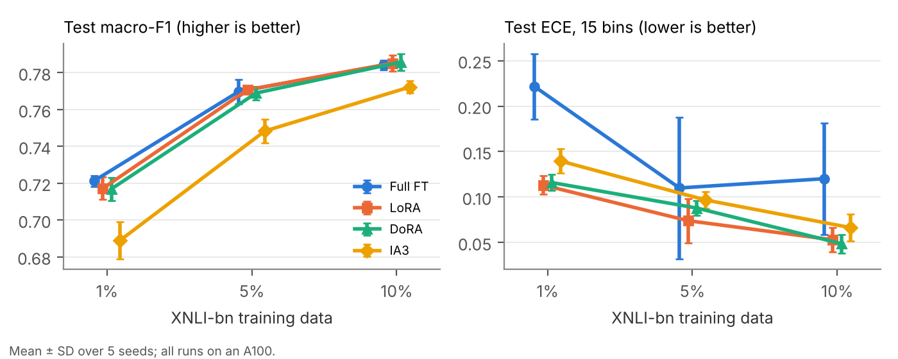
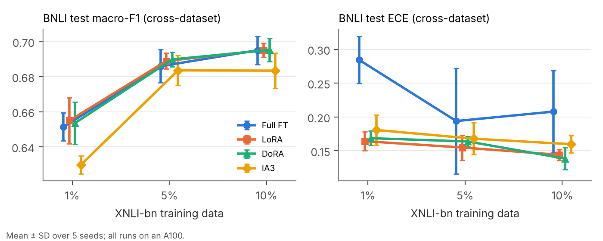

# Parameter-efficient vs full fine-tuning for low-resource Bangla NLI

BSc thesis project. It compares three parameter-efficient fine-tuning (PEFT) methods (LoRA,
DoRA and IA3) with full fine-tuning of [BanglaBERT](https://huggingface.co/csebuetnlp/banglabert)
on 3-class natural language inference, under a matched training budget. It reports both
accuracy and calibration, on two datasets, tested in both directions:

- [XNLI-bn](https://huggingface.co/datasets/csebuetnlp/xnli_bn), with 1%, 5% and 10% of the training set
- [BNLI](https://aclanthology.org/2026.chipsal-1.9.pdf) (Haque et al., CHiPSAL 2026), with a premise-grouped split built here

Every setting is run with five seeds. Every compared run uses one GPU type (NVIDIA A100) and
one library version.

## Summary

All statements below come from [`results/v2/`](results/v2/), which is produced by
[`src/analyze_v2.py`](src/analyze_v2.py). "Robust" means the hierarchical 95% CI excludes zero
**and** the Holm-adjusted seed-level p < 0.05 (see [Statistics](#statistics)).

| | Result |
|---|---|
| Accuracy | LoRA and DoRA show **no measurable difference** from full FT in any setting. Equivalence within ±0.01 macro-F1 is **not** shown. IA3 is less accurate on XNLI-bn (robust at 1% and 10% vs full FT; at 1% and 5% vs LoRA). DoRA is equivalent to LoRA within ±0.01 in all 8 settings. |
| Calibration | At 1% XNLI-bn data, LoRA and DoRA have robustly lower ECE than full FT (0.113 and 0.116 vs 0.221; Holm p = 0.045). The same models tested on BNLI show the clearest effect: all three PEFT methods have robustly lower ECE and Brier score than full FT. At 5% there is no consistent direction (PEFT lower in 2 of 5 seeds). At 10% and on BNLI-trained models the direction favours PEFT in 4–5 of 5 seeds but is not robust. |
| Cross-dataset | Testing on the other dataset costs 5.9–10.2 macro-F1 points. For XNLI-bn-trained models, the drop grows with training size for every method. Whether the drop differs between methods was not tested. |
| Reliability | Training is bit-for-bit reproducible on the same GPU and library version. Changing GPU and library version (T4 vs A100) moved macro-F1 by up to 0.79 points but **ECE by up to 0.096**, close to the size of the main calibration effect. |
| Efficiency | Trainable parameters: LoRA 0.80%, DoRA 0.81%, IA3 0.58%. Saved artefact: 2.6–3.7 MB vs 442.5 MB. Peak GPU memory: 1.57–1.89 GB vs 2.71 GB. On the A100, LoRA trains in about the same time as full FT, DoRA is 1.30–1.49× slower and IA3 is 4–13% faster. |





## Setup

| | |
|---|---|
| Base model | `csebuetnlp/banglabert` (110,619,651 parameters), 3-class sequence classification |
| XNLI-bn | 381,449 train / 2,419 validation / 4,895 test; the test pairs share 1,651 premises |
| Low-resource subsets | 1%, 5%, 10% of XNLI-bn train (3,814 / 19,072 / 38,144 pairs), `train.shuffle(seed).select(range(n))`; same pairs for every method at a given seed (indices not saved) |
| BNLI | 24,067 sheet rows cleaned to 22,519 pairs; premise-grouped 80/10/10 split, 18,013 / 2,254 / 2,252 pairs, no premise shared between splits (details below) |
| Preprocessing | `csebuetnlp/normalizer` on both sentences, sentence-pair tokenisation, max length 128 |
| Full fine-tuning | all parameters, learning rate 2e-5 |
| LoRA | r = 8, α = 16, dropout 0.1, on `query` and `value`, learning rate 2e-4 (887,811 trainable) |
| DoRA | LoRA's exact settings plus `use_dora=True` (906,243 trainable) |
| IA3 | scaling vectors on attention keys and values and on the FFN output-layer input, learning rate 3e-3 (648,195 trainable) |
| Training | 8 epochs, batch 16, fp16, no early stopping, one validation evaluation per epoch |
| Optimiser | not set explicitly, so the transformers 4.54.1 defaults apply: AdamW (fused), weight decay 0, linear decay to 0 with no warmup, gradient clipping at 1.0 |
| Model selection | epoch with the best validation macro-F1; test set scored once per run |
| Seeds | 7, 13, 21, 33, 42 |
| Hardware / software | NVIDIA A100-SXM4-40GB, transformers 4.54.1, peft 0.14.0, torch 2.11.0 (cu128 for 16 runs, cu130 for 64) |

All PEFT methods also train the same 592,899-parameter classifier head, so most of their
trainable parameters are the head (adapters: LoRA 294,912, DoRA 313,344, IA3 55,296).

The LoRA/DoRA and full-FT learning rates are standard values and were not tuned. The IA3
learning rate was chosen from {1e-3, 3e-3, 1e-2} by validation macro-F1 at 5% data with a
seed (0) not used for evaluation (0.7302 / 0.7487 / 0.7462), so IA3 received one selection
step that the other methods did not ([`results/peft/ia3_lrcheck/`](results/peft/ia3_lrcheck/)).

**Why a fixed budget.** In a pilot, early stopping with patience 2 stopped full fine-tuning
at epoch 4 while LoRA was still improving, which made the comparison depend on the stopping
rule. Every method therefore trains for the same 8 epochs and keeps its best validation
checkpoint.

### BNLI cleaning and split

[`src/make_bnli_split.py`](src/make_bnli_split.py) rebuilds the split byte-for-byte from
`BNLI_Dataset.xlsx` (SHA-256 in [`results/bnli/split_sha256.txt`](results/bnli/split_sha256.txt)).
The split files are not redistributed because BNLI's licence was not verified.

- **Cleaning.** 24,067 rows (the paper reports 23,067) → 23,058 after dropping rows with a
  missing field → 23,035 after dropping invalid labels → 22,519 after keeping one copy of
  identical pairs and dropping the 75 pairs that appear with conflicting labels.
- **Split.** Pairs sharing a premise (whitespace- and punctuation-insensitive match, 6,858
  groups) always land in the same split. Split seed 100. Train 18,013 (5,503 premises),
  validation 2,254 (692), test 2,252 (663). Labels use the XNLI-bn ids (contradiction 0,
  entailment 1, neutral 2).
- **Caveat.** Some hypothesis texts recur across splits with different premises (93
  train/validation, 74 train/test, 15 validation/test). BNLI premises are translated from
  SNLI; only the hypotheses were written natively.

## Statistics

For each comparison A − B and each metric (macro-F1, ECE, Brier, NLL, ECE after temperature
scaling):

- a **seed-level** paired t-test over the five seeds;
- a **hierarchical bootstrap** (2,000 resamples): draw five seeds with replacement, then
  resample **premise groups** within each drawn seed, on both test sets;
- **Holm correction** within each evaluation set × metric × family. The primary family is
  each PEFT method vs full FT; the secondary family is DoRA vs LoRA and IA3 vs LoRA.

A difference is **robust** only if the bootstrap CI excludes zero and the Holm-adjusted p <
0.05. **Equivalence** is TOST at ±0.01 macro-F1 on the seed-level differences, Holm-adjusted.
The ±0.01 margin was chosen after the original runs. It was not pre-registered.

ECE uses 15 equal-width bins on top-class confidence over [1/3, 1]; using [0, 1] changes no
conclusion. For temperature scaling, only test logits were saved, so the temperature is
fitted by 5-fold cross-validation on the test set (fit on four folds, apply to the fifth).
This is not the usual validation-set fit and is reported as such.

Every number in `results/v2/` was reproduced by a separate implementation, with no
disagreement on any robust or equivalence verdict.

## Results

Mean ± SD over five seeds. ▼ / ▲ = robustly lower / higher than full FT. The full table of
200 comparisons, with CIs, Holm p-values, TOST and per-seed differences, is in
[`results/v2/comparisons_v2.csv`](results/v2/comparisons_v2.csv) and
[`results/v2/stats_v2.txt`](results/v2/stats_v2.txt).

**Macro-F1 (higher is better)**

| Trained on → tested on | Train data | Full FT | LoRA | DoRA | IA3 |
|---|---|---|---|---|---|
| XNLI-bn → XNLI-bn | 1% | 0.721 ± 0.003 | 0.717 ± 0.006 | 0.717 ± 0.006 | 0.689 ± 0.010 ▼ |
| XNLI-bn → XNLI-bn | 5% | 0.770 ± 0.007 | 0.771 ± 0.002 | 0.769 ± 0.004 | 0.748 ± 0.006 |
| XNLI-bn → XNLI-bn | 10% | 0.784 ± 0.003 | 0.785 ± 0.004 | 0.786 ± 0.004 | 0.772 ± 0.003 ▼ |
| XNLI-bn → BNLI | 1% | 0.651 ± 0.008 | 0.655 ± 0.013 | 0.654 ± 0.012 | 0.630 ± 0.005 ▼ |
| XNLI-bn → BNLI | 5% | 0.686 ± 0.009 | 0.689 ± 0.004 | 0.690 ± 0.004 | 0.684 ± 0.008 |
| XNLI-bn → BNLI | 10% | 0.695 ± 0.008 | 0.695 ± 0.004 | 0.695 ± 0.007 | 0.683 ± 0.010 |
| BNLI → BNLI | all (18,013) | 0.762 ± 0.007 | 0.758 ± 0.002 | 0.758 ± 0.002 | 0.753 ± 0.003 |
| BNLI → XNLI-bn | all (18,013) | 0.670 ± 0.010 | 0.656 ± 0.013 | 0.657 ± 0.013 | 0.652 ± 0.012 |

**ECE, 15 bins (lower is better)**

| Trained on → tested on | Train data | Full FT | LoRA | DoRA | IA3 |
|---|---|---|---|---|---|
| XNLI-bn → XNLI-bn | 1% | 0.221 ± 0.036 | 0.113 ± 0.010 ▼ | 0.116 ± 0.009 ▼ | 0.140 ± 0.013 |
| XNLI-bn → XNLI-bn | 5% | 0.110 ± 0.078 | 0.074 ± 0.024 | 0.088 ± 0.008 | 0.097 ± 0.009 |
| XNLI-bn → XNLI-bn | 10% | 0.120 ± 0.061 | 0.053 ± 0.014 | 0.049 ± 0.010 | 0.066 ± 0.015 |
| XNLI-bn → BNLI | 1% | 0.284 ± 0.035 | 0.164 ± 0.014 ▼ | 0.169 ± 0.011 ▼ | 0.181 ± 0.022 ▼ |
| XNLI-bn → BNLI | 5% | 0.194 ± 0.078 | 0.155 ± 0.018 | 0.164 ± 0.007 | 0.168 ± 0.024 |
| XNLI-bn → BNLI | 10% | 0.208 ± 0.061 | 0.144 ± 0.008 | 0.138 ± 0.016 | 0.160 ± 0.013 |
| BNLI → BNLI | all (18,013) | 0.162 ± 0.046 | 0.081 ± 0.007 | 0.083 ± 0.008 | 0.085 ± 0.011 |
| BNLI → XNLI-bn | all (18,013) | 0.214 ± 0.087 | 0.098 ± 0.022 | 0.100 ± 0.019 | 0.112 ± 0.031 |

**Points the tables do not show**

- At 1% on XNLI-bn, Brier, NLL and ECE after temperature scaling also favour LoRA and DoRA
  in 5 of 5 seeds, but none of them is robust (Holm p 0.073–0.127). On the BNLI test, ECE
  and Brier are both robust.
- The in-domain ECE result for LoRA and DoRA at 1% passes with Holm p = 0.045, close to the
  threshold. The cross-dataset version is much clearer (Holm p = 0.003 / 0.005 / 0.012).
- Full FT's ECE varies far more across seeds than any PEFT method's (XNLI-bn SD 0.036 /
  0.078 / 0.061 at 1/5/10%, vs LoRA 0.010 / 0.024 / 0.014).
- IA3 vs LoRA: robustly worse Brier and NLL at all three XNLI-bn fractions; ECE not robustly
  different anywhere. Trained and tested on BNLI, IA3 is equivalent to LoRA in macro-F1.
- Trained on BNLI and tested on XNLI-bn, LoRA and DoRA are 1.3–1.4 macro-F1 points below
  full FT in 4 of 5 seeds; not robust (Holm p = 0.287).

### Reliability

- **Reproducibility.** Eight full-FT runs retrained later reproduced their original XNLI-bn
  test logits exactly, although the re-runs used the torch cu130 build and the originals
  cu128. Eight saved LoRA adapters re-scored the same macro-F1 exactly.
- **Hardware.** 14 runs were first trained on a Tesla T4 (transformers 5.15.0, peft 0.20.0)
  and re-trained on the A100. The same (method, fraction, seed) moved by up to 0.79
  macro-F1 points (mean 0.31) and by up to 0.096 ECE (mean 0.021). The largest change was
  full FT at 1%, seed 7: ECE 0.254 → 0.158, mean confidence 0.967 → 0.879
  ([`results/v2/hardware_t4_vs_a100.csv`](results/v2/hardware_t4_vs_a100.csv)). Only the
  A100 runs are compared.
- **Prediction agreement.** At 1% on XNLI-bn, two full-FT models with different seeds agree
  on 81.3% of test predictions, and full FT vs LoRA with the same seed on 83.2%. Changing the
  method therefore disagrees no more than changing the seed. LoRA and DoRA agree on 98.2%
  ([`results/v2/agreement_v2.csv`](results/v2/agreement_v2.csv)).

### Convergence and efficiency

PEFT methods reach their best validation epoch later than full FT. At 5% XNLI-bn, full FT's
mean best epoch is 2.6 vs 6.6–7.4 for the PEFT methods. At 1% and 5%, each PEFT method hit
the 8-epoch limit in 2–3 of 5 seeds; full FT never did. On BNLI every method hit it once
([`results/v2/convergence_v2.csv`](results/v2/convergence_v2.csv)).

| A100, batch 16 | Full FT | LoRA | DoRA | IA3 |
|---|---|---|---|---|
| Trainable parameters | 110,619,651 (100%) | 887,811 (0.803%) | 906,243 (0.819%) | 648,195 (0.586%) |
| Saved model | 442.51 MB | 3.57 MB | 3.65 MB | 2.61 MB |
| Peak GPU memory | ≈ 2.71 GB | ≈ 1.57 GB | ≈ 1.76 GB | ≈ 1.89 GB |
| Training time vs full FT | 1× | 0.99–1.07× | 1.30–1.49× | 0.87–0.96× |

Source: [`results/v2/efficiency_v2.csv`](results/v2/efficiency_v2.csv). Times are wall-clock
for the fixed 8-epoch budget on one GPU type.
Percentages are of the 110,619,651-parameter model. The `pct_trainable` column in that
file (0.796 / 0.813 / 0.583) divides by PEFT's larger total instead, which also counts the
adapter and a second copy of the classifier head (`modules_to_save`).

## Limitations

- **Five seeds per setting.** Intervals are wide and the Holm correction is strict. Several
  differences point the same way in every seed but are not robust.
- **Fixed 8-epoch budget.** The PEFT methods often peaked at the last epoch at 1–5% data, so
  longer training might help them.
- **Learning rates.** LoRA/DoRA and full-FT rates were not tuned. IA3 received one
  validation-only selection step that the others did not. DoRA used LoRA's rate.
- **Temperature scaling** was fitted on the test set by cross-validation, because only test
  logits were saved.
- **TOST margin** (±0.01) was chosen after the original runs.
- **BNLI** premises are translated, so BNLI reduces but does not remove translation
  effects. Hypothesis texts recur across splits.
- **Three data sizes** are three points, not a scaling curve.
- **Training subsets were not saved.** Their nesting across fractions holds by construction
  of the code, not by a check against the runs.
- **One GPU type.** The hardware experiment shows that calibration in particular can shift
  with GPU and library version. The results hold for the A100 setup used here.

## Reproducing

Statistics and figures, CPU only:

```bash
pip install numpy pandas scipy scikit-learn matplotlib
python src/analyze_v2.py          # results/v2/*.csv and stats_v2.txt (N_BOOT=200 for a quick run)
python src/analyze_v2_extra.py    # convergence, efficiency, agreement, figures/v2_*.png
```

BNLI split (needs `BNLI_Dataset.xlsx` from the BNLI authors):

```bash
pip install openpyxl
python3 -I src/make_bnli_split.py BNLI_Dataset.xlsx bnli_split 100
```

Training: [`notebooks/peft_train_colab.ipynb`](notebooks/peft_train_colab.ipynb) (DoRA, IA3,
the A100 re-runs and the cross-dataset completion) and
[`notebooks/bnli_train_colab.ipynb`](notebooks/bnli_train_colab.ipynb) (BNLI runs). The
original XNLI-bn full-FT/LoRA runs came from an earlier version of the same Colab engine.
[`src/train.py`](src/train.py) keeps the same training and evaluation settings without the
unattended-run tooling, but was not used to produce the published runs.

## Repository layout

See [`results/README.md`](results/README.md) for which result files are final and which are
superseded, and for the file naming.

```
src/
  analyze_v2.py         four-method statistics (final)
  analyze_v2_extra.py   convergence, efficiency, agreement, figures (final)
  make_bnli_split.py    BNLI cleaning and premise-grouped split
  data.py, train.py     training settings as a plain script
  analyze.py            earlier two-method analysis (superseded)
notebooks/              Colab training notebooks
analysis/
  robustness_v2.ipynb   earlier two-method calibration CIs (superseded)
results/                run manifests, per-epoch curves, test logits, analysis outputs
figures/                v2_*.png final; dev_curves.png and f1_and_ece.png superseded
```

## Earlier analysis (superseded)

An earlier version of this project compared only LoRA and full FT on 30 XNLI-bn runs, 14 of
which ran on a T4 and 16 on an A100. Its outputs (`results/results.csv`, `results/stats.txt`,
`results/robustness/`, `src/analyze.py`, `analysis/robustness_v2.ipynb`) are kept for the
record. They are replaced by the all-A100 four-method analysis above, which changes two of
their conclusions: equivalence of LoRA with full FT is no longer shown, and the 1% Brier, NLL
and post-temperature-scaling calibration gaps are no longer robust after Holm correction.

## License

MIT. BanglaBERT and XNLI-bn are from [CSE-BUET NLP](https://github.com/csebuetnlp). BNLI is
from Haque et al. (CHiPSAL 2026).
